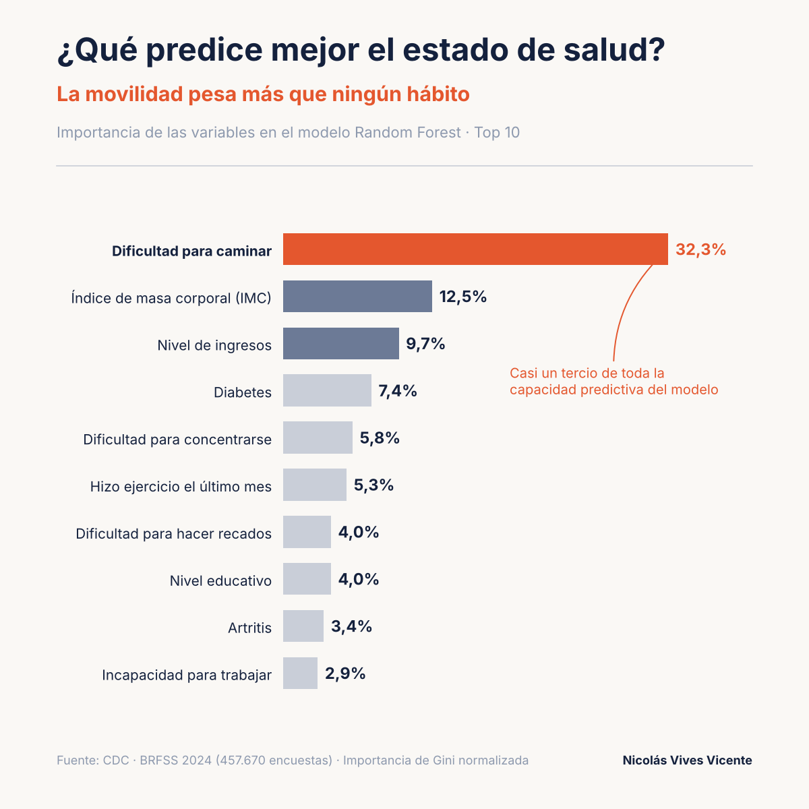

# Análisis del Perfil de Salud en EE. UU.: Modelado Predictivo y Segmentación

[Español](#español) · [English](#english)

---

## Español

### Resumen

¿Hasta qué punto se puede predecir el estado de salud de una persona a partir de sus hábitos y de su contexto socioeconómico? Este proyecto de Machine Learning aborda la pregunta con datos reales del **BRFSS 2024** (Behavioral Risk Factor Surveillance System, CDC): más de 457.000 encuestas y 301 variables.

Se aplica un pipeline completo de aprendizaje supervisado (clasificación y regresión) y no supervisado (clustering), con énfasis en la **interpretabilidad** de los modelos y en el **análisis de sesgos**.

### Resultados principales

- **Variable objetivo:** estado de salud autopercibido en 5 niveles (de peor salud a salud excelente).
- **El accuracy no basta.** Gradient Boosting obtuvo el mejor accuracy (≈ 0,46), pero casi no detectaba a las personas con salud excelente (recall ≈ 0,08). Una regresión logística con clases balanceadas detectó mucho mejor ambos extremos (recall ≈ 0,65) a costa de más falsos positivos. Se eligió **Random Forest** como mejor equilibrio global (mejor F1 macro, ≈ 0,38).
- **La movilidad es el predictor dominante.** La dificultad para caminar concentra cerca de un tercio de la importancia en el Random Forest, seguida del IMC, el nivel de ingresos y la diabetes.
- **IMC (regresión):** el problema resulta mucho más difícil (R² ≈ 0,12 en test). Los modelos tienden a la media y no capturan los casos extremos.
- **Segmentación (K-Means, k = 5, con PCA para interpretar):** aparece un grupo de peor salud, con más diabetes y artritis, menos actividad física y menores niveles de ingresos y educación. DBSCAN se usó como contraste.

### Metodología

1. **Limpieza y preparación.** Muchas variables superaban el 50 % de nulos, pero la mayoría eran preguntas condicionales (por ejemplo, no se pregunta cuánto fuma quien no fuma). En lugar de imputar a ciegas, se crearon escalas ordinales de riesgo (tabaco, alcohol) e indicadores de "no respondió". Se eliminaron valores fuera de rango (5.942 filas), quedando 451.728 registros.
2. **Clasificación.** Árbol de decisión, regresión logística, SVC, Random Forest, Gradient Boosting y Stacking, con más de 50 configuraciones evaluadas.
3. **Regresión del IMC.** Árbol de decisión, Ridge y SVR.
4. **Clustering.** K-Means y DBSCAN, con selección de *k* por métricas y PCA para visualizar e interpretar los grupos.
5. **Interpretabilidad y sesgos.** Importancia de variables, coeficientes de la regresión logística y auditoría de los modelos por sexo, incluyendo el efecto del balanceo de clases.

### Datos

- **Fuente:** BRFSS 2024, CDC (encuesta telefónica anual sobre salud y hábitos en EE. UU.).
- **Tamaño:** 457.670 filas y 301 columnas.
- **Contenido:** variables demográficas, biométricas, de estilo de vida, enfermedades crónicas y factores socioeconómicos.

### Stack tecnológico

- **Lenguaje:** Python
- **Machine Learning:** `scikit-learn`
- **Manipulación de datos:** `pandas`, `numpy`
- **Visualización:** `matplotlib`, `seaborn`
- **Entorno:** Jupyter Notebook / Kaggle

### Cómo ejecutarlo

1. Clona el repositorio e instala las dependencias: `pip install pandas numpy scikit-learn matplotlib seaborn`.
2. Descarga el dataset BRFSS 2024 y ajusta la ruta de lectura en el notebook.
3. Abre `Análisis_Salud_EEUU.ipynb` y ejecuta las celdas en orden.

### Limitaciones

- El estado de salud es **autopercibido**, no un diagnóstico clínico.
- Los datos proceden de una encuesta: pueden incluir sesgos de respuesta y de muestreo.
- Las asociaciones que encuentran los modelos **no implican causalidad**.

---

## English

### Summary

How well can a person's health status be predicted from their habits and socioeconomic background? This Machine Learning project tackles the question with real **BRFSS 2024** data (Behavioral Risk Factor Surveillance System, CDC): over 457,000 survey responses and 301 variables.

It applies a complete pipeline of supervised (classification and regression) and unsupervised (clustering) learning, with emphasis on model **interpretability** and **bias analysis**.

### Key Results

- **Target variable:** self-rated health status on a 5-level scale (from poorest to excellent health).
- **Accuracy is not enough.** Gradient Boosting achieved the best accuracy (≈ 0.46) but almost never identified people in excellent health (recall ≈ 0.08). A class-balanced logistic regression detected both extremes far better (recall ≈ 0.65) at the cost of more false positives. **Random Forest** was selected as the best overall trade-off (best macro F1, ≈ 0.38).
- **Mobility is the dominant predictor.** Difficulty walking accounts for roughly a third of Random Forest feature importance, followed by BMI, income level and diabetes.
- **BMI (regression):** a much harder task (R² ≈ 0.12 on the test set). Models regress to the mean and fail to capture extreme cases.
- **Segmentation (K-Means, k = 5, with PCA for interpretation):** one group stands out with poorer health, more diabetes and arthritis, less physical activity, and lower income and education levels. DBSCAN was used as a comparison.

### Methodology

1. **Cleaning and preparation.** Many variables had over 50% missing values, but most reflected conditional questions (for example, non-smokers are not asked how much they smoke). Instead of blind imputation, ordinal risk scales (tobacco, alcohol) and "no answer" indicators were built. Out-of-range values were removed (5,942 rows), leaving 451,728 records.
2. **Classification.** Decision tree, logistic regression, SVC, Random Forest, Gradient Boosting and Stacking, with over 50 configurations evaluated.
3. **BMI regression.** Decision tree, Ridge and SVR.
4. **Clustering.** K-Means and DBSCAN, with *k* selected using validation metrics and PCA to visualize and interpret the groups.
5. **Interpretability and bias.** Feature importance, logistic regression coefficients, and a model audit by sex, including the effect of class balancing.

### Data

- **Source:** BRFSS 2024, CDC (annual US telephone survey on health and behaviors).
- **Size:** 457,670 rows and 301 columns.
- **Content:** demographic, biometric and lifestyle variables, chronic conditions and socioeconomic factors.

### Tech Stack

- **Language:** Python
- **Machine Learning:** `scikit-learn`
- **Data manipulation:** `pandas`, `numpy`
- **Visualization:** `matplotlib`, `seaborn`
- **Environment:** Jupyter Notebook / Kaggle

### How to Run

1. Clone the repository and install the dependencies: `pip install pandas numpy scikit-learn matplotlib seaborn`.
2. Download the BRFSS 2024 dataset and adjust the data path in the notebook.
3. Open `Análisis_Salud_EEUU.ipynb` and run the cells in order.

### Limitations

- Health status is **self-reported**, not a clinical diagnosis.
- The data comes from a survey and may include response and sampling bias.
- The associations found by the models **do not imply causation**.

